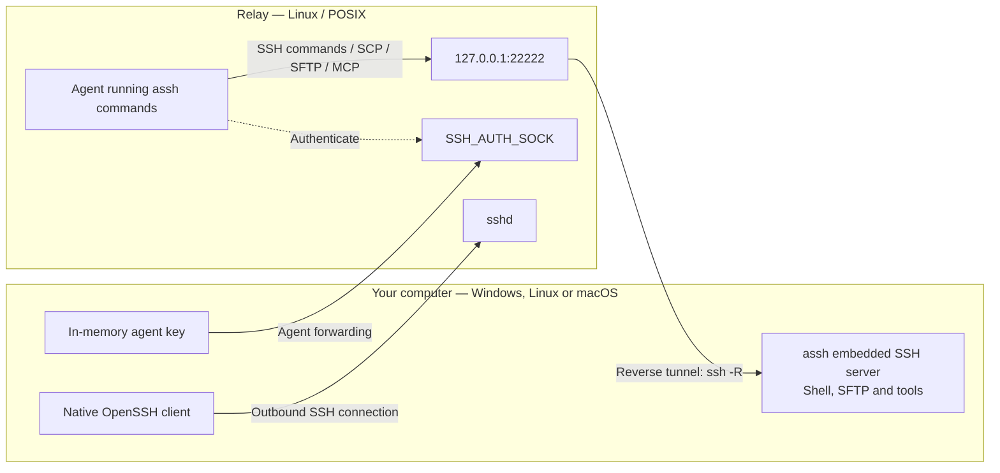

# agent_ssh

`assh` lets an agent on a Linux server work on your computer as if it were sitting at it. Your computer can run Windows, Linux or macOS.

On your computer, `assh` starts an SSH server for your own user. Your normal OpenSSH client then dials out to the Linux server (the *relay*), and the reverse tunnel maps that SSH server onto the relay's loopback interface. Anything on the relay can then run PowerShell, move files, forward ports or speak MCP to your computer over plain SSH. No inbound port is opened, no key is copied, and nothing is installed or written on the relay.



## Platforms

| Your computer | Commands run in | Status |
| --- | --- | --- |
| Windows 10 1809+ / 11 | PowerShell 7, falling back to Windows PowerShell 5.1 | Primary target; covered by the full integration suite |
| Linux | bash (change with `--shell`) | Tested end to end: tunnel, tools, file transfer, interactive login with MOTD and resize |
| macOS | bash (change with `--shell`) | Unit tests in CI on `macos-latest`; a full SSH QA pass on an arm64 runner with the system Bash 3.2 (tools, files, SCP/SFTP, forwarding, MCP, reconnect) |

These features exist on Windows only:

- `clip get/set`
- the Git Bash and WSL entry points (`assh bash` on Linux and macOS is the native bash)
- the crash-recovery cleanup of escaped processes. It addresses a Windows job-object gap; on Unix, process groups end whole trees.

The relay is always a Linux (or other POSIX) server.

## Quick start

Download the archive for your platform from [Releases](https://github.com/manytokens/agent_ssh/releases): Windows, Linux and macOS, each for amd64 and arm64. Every archive has a `.sha256` file next to it and contains `assh` (`assh.exe` on Windows), `LICENSE` and `README.md`.

To build any platform yourself, use Go 1.26.6+:

```sh
go build -o bin/assh ./cmd/assh      # bin/assh.exe on Windows
```

Requirements:

- **On your computer:** the system OpenSSH client 8.7+. Windows also needs PowerShell 7 or Windows PowerShell 5.1.
- **On the relay:** OpenSSH with TCP and agent forwarding allowed, a POSIX login shell, and `bash`, `base64` and `gzip`. Python 3.9+ is needed only for `assh put/get/sync`.

```powershell
# Once: make sure non-interactive key login to the relay works.
assh login user@relay

# Connect. You land in a Bash shell on the relay.
assh user@relay -p 2222 -o ServerAliveInterval=3

# Any ssh arguments work, e.g. a jump host, a port forward and your own agent.
assh -J me@bastion user@relay -L 8080:127.0.0.1:3000 -A
```

In that relay shell, the `assh` function reaches back to your computer:

```bash
assh run 'Get-Location; Get-Date'
assh put ./build.zip 'D:/drop/build.zip'
assh status
```

Exiting the relay shell stops everything: the tunnel, the embedded server and every process it started.

## How it works

- **One process, one session.** `assh user@relay` runs the embedded SSH server, the reverse tunnel and your interactive login in a single process. `start`, `run` and `stop` provide a background service instead.
- **Your OpenSSH, your config.** The tunnel and the login use the system `ssh` with your `~/.ssh/config`, keys, ssh-agent and jump hosts, and with your ssh arguments as given (see [OpenSSH arguments](#openssh-arguments)). The tunnel runs with `BatchMode=yes` and `StrictHostKeyChecking=yes`, so it never prompts and never accepts an unknown relay host key.
- **In-memory authorization.** Each start creates an Ed25519 key that exists only in assh's memory. It is offered to the relay through a dedicated forwarded agent, and the embedded server trusts it. The relay never sees a private key, and authorization ends with the process. `authorize FILE` adds further keys for agents elsewhere.
- **Strict in both directions.** The relay side verifies your computer's persistent host key, which is passed on the command line (`KnownHostsCommand`), so no known_hosts file is involved.
- **Readiness.** Before the tunnel counts as online, the relay checks two things in parallel. `ssh-keyscan` must find your computer's host key behind the forwarded port, and the forwarded agent must answer `ssh-add -l`. Without `ssh-keyscan`, a full login to the in-process `ping` tool is used.
- **Native login.** `ssh` runs directly on your terminal, so resizing, wrapping, full-screen programs and Ctrl+C behave exactly as with plain `ssh`. The relay environment arrives as a compressed rcfile inside the session command (about 10 KB). Nothing is typed into the shell. Bash 4+ reads the rcfile from a pipe. Bash 3 (as on macOS) cannot, so it gets a private temporary file that deletes itself before any profile runs. The rcfile:
  1. prints `/run/motd.dynamic` and `/etc/motd`;
  2. loads `/etc/profile` and the first of `~/.bash_profile`, `~/.bash_login` and `~/.profile`, once;
  3. defines the helpers.

  `Last login` is not shown, and the shell is interactive rather than a login shell; `logout` and `~/.bash_logout` still work.
- **Reconnects.** A lost tunnel is retried with backoff (1 s doubling to 30 s, with jitter). The relay port is kept, and the helpers find the new agent socket by themselves. With the default `--remote-port 0`, the first free port from 22222 to 22285 is used.

## On the relay

The login shell defines `assh` and `asscp`, plus these variables. Agents started from that shell inherit them.

| Variable | Meaning |
| --- | --- |
| `ASSH_HOST`, `ASSH_PORT`, `ASSH_USER` | Where your computer's SSH server is reachable on the relay |
| `ASSH_HOST_KEY` | Its host key, for strict verification |
| `ASSH_SSH_COMMAND`, `ASSH_SCP_COMMAND` | Complete `ssh`/`scp` prefixes with port, host verification and `IdentityAgent=$ASSH_AGENT_SOCKET` |
| `ASSH_AGENT_SOCKET` | The tunnel's forwarded agent socket, which holds the in-memory key |
| `ASSH_CONNECTION_JSON` | `host`, `port`, `user`, `host_key`, `target_os` as JSON |
| `ASSH_AGENT_HELP` | The capability hint shown at login |

`SSH_AUTH_SOCK` is left to OpenSSH: it is your own agent when you log in with `-A` (or `ForwardAgent`), and unset otherwise. The helpers never use it.

The tunnel's agent socket changes when the tunnel reconnects. Before each call, the helpers look it up in the environment of the tunnel's session process on the relay (Linux `/proc`; only your own processes are readable) and update `ASSH_AGENT_SOCKET`. Programs that use `ASSH_SSH_COMMAND` directly read `ASSH_AGENT_SOCKET` from their own environment; after a reconnect, run `__assh_agent` first (it is exported to child Bash shells) or go through the `assh` function. Without `/proc`, the socket from login time is used.

Calls from one shell share a single SSH connection through OpenSSH ControlMaster. The control socket goes in `$XDG_RUNTIME_DIR` when that directory is yours and short enough for a socket path; `ASSH_NO_MUX=1` disables sharing. Processes outside this shell can use the `relay_command` printed by `status`. Re-read it after a reconnect, because the agent socket changes.

### Tools

| Command | Purpose |
| --- | --- |
| `assh run [--timeout 30s] [--json] [--cwd DIR] 'script'` | Run a script: PowerShell on Windows, bash on Linux and macOS |
| `assh bash [-lc 'script']` | Git Bash on Windows (never the WSL `bash.exe` shim), native bash elsewhere |
| `assh wsl [-d DISTRO] [-u USER] [--cwd DIR] -- ARGS` | Run inside WSL (Windows only) |
| `assh put SRC DEST` / `assh get SRC DEST` | Verified, resumable file or directory transfer |
| `assh sync SRC DEST [--exclude PATTERN]` | Upload only changed 1 MiB blocks; extra target files are kept |
| `assh fs ls\|stat\|hash\|find PATH --json` | Structured filesystem queries |
| `assh watch DIR` | Recursive change events as JSON lines |
| `assh session new\|send\|read\|attach\|close` | A long-lived shell that keeps cwd, variables and modules |
| `assh job start\|log\|wait\|kill\|list` | Background jobs that survive the calling SSH connection |
| `assh info`, `assh ps`, `assh ports` | Environment, processes and listening ports as JSON |
| `assh status` | Tunnel phase, reconnects, uptime, last error, metrics, live sessions and jobs |
| `assh clip get\|set` | Plain-text clipboard (Windows only; needs `--allow-clipboard`) |
| `assh mcp` | MCP server over SSH stdio |
| `assh dry-run OP ...` / `--dry-run` | Show what an operation would do without doing it |
| `assh help`, `assh capabilities --json` | Discovery |
| `asscp SRC DEST` | `scp` with the right port, host key and drive-path conversion |

On the relay, `assh -N -L 127.0.0.1:8080:127.0.0.1:3000` and `assh -N -R ...` forward ports to and from your computer. Any other first argument is passed to `ssh` as is, so `assh 'Get-Process'` runs a plain exec.

### Execution

On Linux and macOS, scripts run as `bash -c`, and exit codes and timeouts work as usual; process groups end whole trees. The rest of this section describes Windows.

- **PowerShell setup.** Scripts run as a fresh `pwsh -NoProfile -NonInteractive` with UTF-8 I/O and `$ErrorActionPreference='Stop'`. The script travels in a temporary file that is deleted once read, so length is unlimited, and syntax errors report your own line and column.
- **Exit code.** An explicit `exit N` wins. Otherwise the last statement decides: a failing native command passes its `$LASTEXITCODE`, a failing cmdlet gives 1, and success gives 0. Codes are signed, so `exit -1` is -1.
- **`--json`.** Returns `stdout`, `stderr`, `exit_code`, `duration`, `timed_out` and `truncated`, keeping the last 4 MiB per stream. Non-UTF-8 output adds `binary` and a byte-exact `stdout_base64`.
- **Timeouts and kills.** `--timeout`, `job kill`, `session close` and a dropped client end the whole process tree. That includes processes started by a Microsoft Store `pwsh.exe`, which escape the job object. If assh itself is killed, the next start ends the processes it recorded in `processes.json`, matched by PID and creation time.
- **Sessions.** A multi-line `session send` gets the blank line that PowerShell needs to run the block.
- **No translation.** Scripts are not translated between PowerShell and Bash.

### Files and paths

- **Tool paths.** On Windows, `put/get/sync/fs` accept `D:/x`, `/D:/x` and `/d/x`. Relative paths start at `--workdir`, which defaults to the directory assh was started in.
- **SFTP paths.** For a Windows computer, plain SFTP and `scp` understand drives only as `/D:/x`. `asscp` converts `D:/x`, `D:\x` and `/d/x` for you; raw `scp`, `sftp` and `$ASSH_SCP_COMMAND` do not.
- **How transfers work.** Files move in 1 MiB SHA256-checked blocks through a `.part` file, which is renamed once the whole file verifies. Interrupted transfers resume, an identical target is left untouched, and directories stream as tar. All RPCs of one transfer share one SSH connection, and failed connections are retried.
- **Names Windows would mangle are refused:** a `:` (alternate data stream), `*?"<>|`, a trailing dot or space, and device names such as `CON` or `nul.txt`.
- **`sync`.** It honours the source `.gitignore` and `--exclude` patterns, including `*`, `?`, `**`, `!`, anchors, character classes and escapes. `--text` converts CRLF to LF; otherwise bytes are kept exactly.

### MCP

`assh mcp` speaks newline-delimited JSON-RPC on stdout, with no banner. It offers the tools `command`, `run`, `put`, `get`, `ls`, `hash`, `info`, `fs`, `session`, `job`, `ps`, `ports`, `clip` and `status`.

- **Concurrency:** calls run concurrently.
- **Output:** each stream is capped at 8 MiB and flagged `truncated`. `stdout_base64` is present only for binary output.
- **`put`:** requires `stdin_base64`.
- **Cancellation:** a cancelled call is killed and, per the spec, not answered.

```json
{"mcpServers":{"my-pc":{"command":"bash","args":["-c","assh mcp"]}}}
```

## On your computer

```powershell
assh [options] SSH-ARGS                # tunnel + interactive login, one process
assh start  [options] SSH-ARGS         # background service only
assh run    [options] SSH-ARGS         # service in the foreground (Ctrl+C stops)
assh status [--json]                   # state, metrics, relay_command
assh stop
assh login  SSH-ARGS                   # plain ssh SSH-ARGS, e.g. to accept the host key
assh authorize [FILE]                  # trust extra agent keys (default ~/.ssh/authorized_keys)
assh init                              # create the profile and host key ahead of time (optional)
assh exec [--json] 'script'            # run a tool locally
assh --version
```

`SSH-ARGS` is the relay destination plus any ssh options, before or after it; see [OpenSSH arguments](#openssh-arguments). assh's own options are long names:

| Option | Meaning |
| --- | --- |
| `--remote-port N` | Fixed relay port; `0` (default) picks 22222-22285 |
| `--workdir DIR` | Initial directory for commands and relative paths |
| `--shell PATH` | Default shell (pwsh/powershell on Windows, bash on Linux and macOS) |
| `--ssh PATH` | OpenSSH client to use (default `ssh` from PATH) |
| `--no-shell` | With `assh user@relay`: start the tunnel detached, like `start` |
| `--state-dir DIR` | Profile directory; one connection per profile |
| `--allow-clipboard` | Enable `clip get/set` |
| `--no-audit` | Do not write `audit.jsonl` |
| `--events-file PATH`, `--event-webhook URL` | Where connection events go |
| `--connect-timeout N` | OpenSSH connect timeout in seconds |

### OpenSSH arguments

assh takes only its own long options (above; `--name` or `-name`). Every other argument goes to `ssh` unchanged and in its original order: `-J`, `-L`, `-R`, `-D`, `-A`, `-v`, `-p`, `-i`, `-F`, `-o` and any option a future OpenSSH adds. assh does not check them. Before connecting, it lets `ssh -G` evaluate them, so a mistake stops assh at once with OpenSSH's own message. Everything after `--` also goes to OpenSSH.

assh runs up to three `ssh` processes, and they receive these arguments differently:

- **Interactive login: all of them.** So `-L`/`-R`/`-D` forwards live as long as the login, `-A` forwards your own agent to the relay shell, and `-v` shows OpenSSH's debug output. assh only adds `-tt` and its session command, which it passes as `RemoteCommand`. A remote command given after the destination is therefore rejected by OpenSSH.
- **Background tunnel and health probe: the connection options only**, such as jump host, port, user, identity, config, ciphers, `-o` options, `-v`. Options that belong to a session are skipped: forwards, `-A`/`-a`, `-N`, `-f`, `-t`/`-T`, `-W`, `-O`, `-M`/`-S`, `-q`, `-E`/`-y`, X11, and session-level `-o` options such as `LocalForward` or `RequestTTY`. Options assh does not know are passed on. The tunnel always forwards assh's in-memory agent, never yours.
- **Without a login** (`start`, `run`, `--no-shell`), the tunnel is the only connection, so it also takes the `-L`/`-R`/`-D` forwards (and the matching `-o` options).

One limit comes from OpenSSH itself: forwards written in `~/.ssh/config` cannot be removed for a single connection (`ClearAllForwardings` would also remove assh's own `-R`). The background tunnel opens them too, and the login then reports `Address already in use` for those ports. The forwards still work, through the tunnel. To give them to the login alone, put them on the command line or under a separate `Host` alias.

The profile lives in `%APPDATA%\agent_ssh` on Windows, `~/.config/agent_ssh` on Linux, and `~/Library/Application Support/agent_ssh` on macOS. It holds:

- the persistent host key, which is your device identity
- extra `authorized_keys`
- `assh.log`
- `events.jsonl` with connection state changes
- `audit.jsonl`
- `processes.json`
- job logs under `jobs/`

Every remote operation is appended to `audit.jsonl`, rotated beyond 10 MiB:

- connects and disconnects
- each tool call with its arguments truncated to 512 bytes
- each plain exec with its script

Each entry carries the exit code, error and duration. Input data is never logged. SFTP, scp and port forwards appear only as their connection's connect and disconnect.

## Security notes

- Agents act as **your** local user with your full permissions. `--workdir` is a starting directory, not a sandbox, and the SSH user name is only a label.
- Only the relay account that holds the forwarded agent (or a key you `authorize`) can connect, and only through the relay's loopback interface.
- Nothing persistent is written on the relay; only a Bash 3 relay briefly holds the self-deleting rcfile. The relay still keeps its normal SSH logs and shell history.
- The temporary agent socket disappears with the session. `assh connection --write FILE` writes an explicit snapshot when you want one. It is not a credential and goes stale after a reconnect.

## Limits

- No Windows service, start-at-boot or self-update. A crashed or logged-off session does not restart itself.
- Jobs and sessions end with the service that owns them and are not resumed after a restart.
- Directory transfers are committed file by file, not atomically. ACLs, owners and modes are not preserved.
- Legacy `scp -O` is not supported. Use the default SFTP mode.

## Development

```sh
go build ./... && go vet ./... && go test -timeout 90s ./...
GOOS=windows go build -o bin/assh.exe ./cmd/assh
```

`tests/integration/windows.ps1`, run in PowerShell 7 on Windows, builds everything and starts a disposable Docker OpenSSH relay. It then exercises the real path **Windows client → relay → embedded SSH**:

- PowerShell 7 and 5.1, exit codes and process-tree cleanup
- SCP/SFTP, forwards, reconnection after a relay restart
- the native login (MOTD, profile loaded once, no bootstrap leaking)
- the tools over SSH and MCP

It uses only credentials under `work/integration` and removes its container afterwards.

| Package | Role |
| --- | --- |
| `internal/app` | CLI, service lifecycle, local control API |
| `internal/tunnel` | OpenSSH arguments, readiness, reconnects, relay login rcfile and helpers |
| `internal/localssh` | Embedded SSH server (sshd-lite), exec, audit hooks |
| `internal/reverseagent` | In-memory agent over a unix socket or a per-user named pipe |
| `internal/execsvc` | Execution, PowerShell wrapper, PTY/ConPTY, sessions, jobs |
| `internal/filesvc` | File tools, block transfer, tar, sync, watch, Python relay client |
| `internal/tools`, `internal/toolrpc` | Tool dispatch, argv protocol, MCP |
| `internal/platform` | Job objects, process-tree kill and tracking, profile lock |
| `internal/state`, `internal/audit`, `internal/sysinfo`, `internal/telemetry` | Keys and state files, audit log, system queries, events and metrics |

Dependencies: `github.com/jpillora/sshd-lite` at commit `42b505a0cdf50f782210060f9d836974d291dcc3` (MIT), and upstream `github.com/jpillora/sftp` v1.13.15 (BSD), unpatched.
